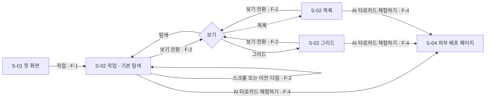

# 박연서 웹 포트폴리오 유저플로우

## 작성자와 관심사 살펴보기 (시나리오 1)

## 대표 프로젝트 확인 (시나리오 2 · 3)

- 모바일 탐색에서는 이전·다음 버튼으로 미리보기를 바꾼다. (F-3)
- 모션 감소 환경에서는 활성 그래픽을 즉시 표시한다. (F-3)
- 공유 카드 제목과 설명에서 서비스 링크를 열면 첫 화면으로 진입한다. (F-6)
